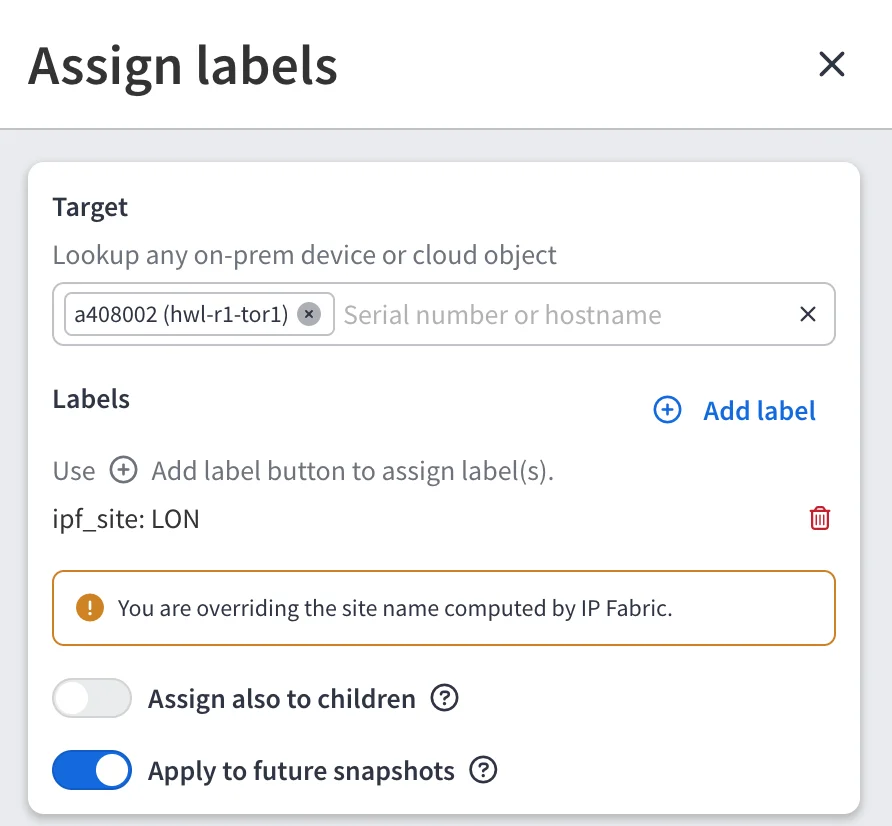
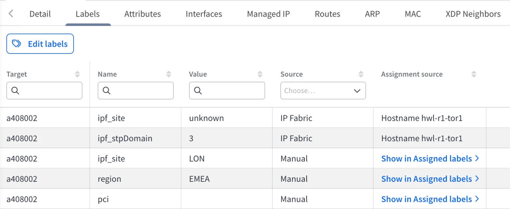
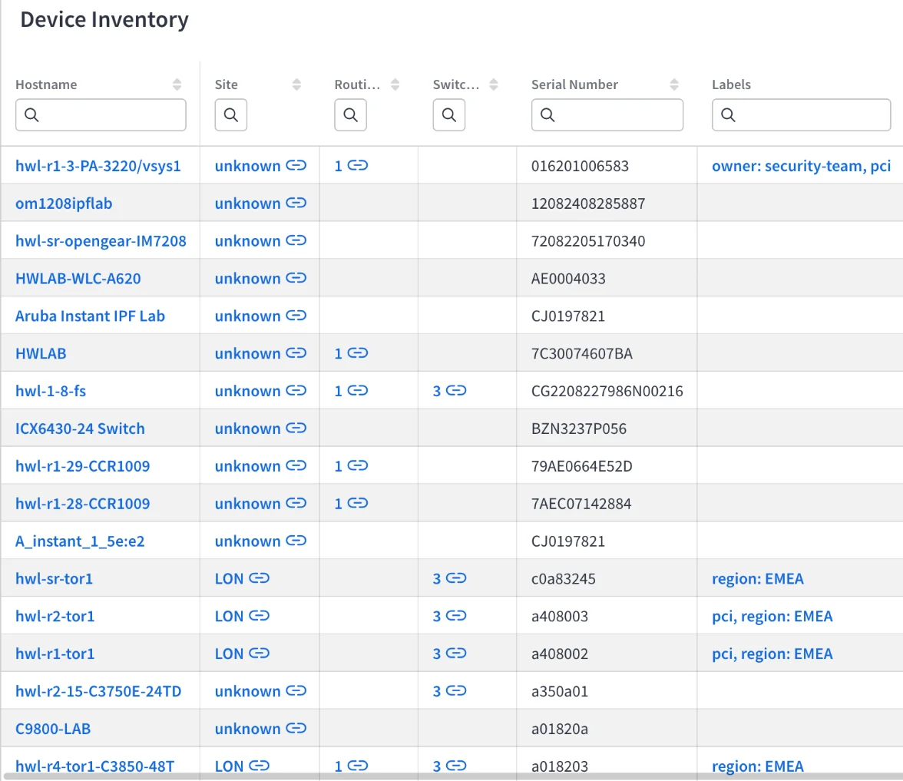
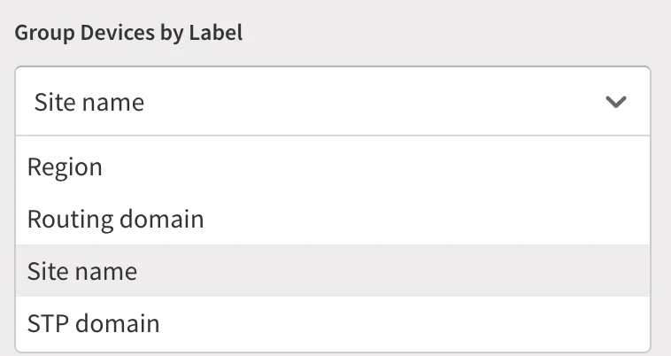
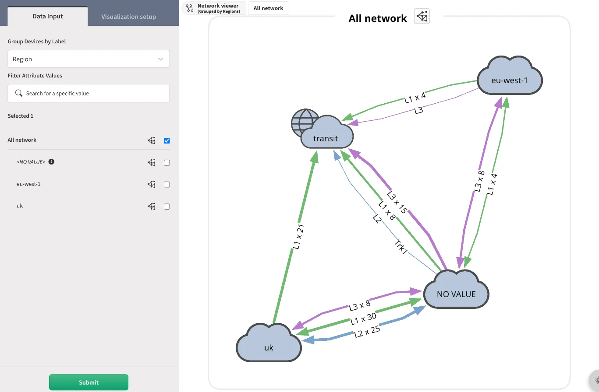
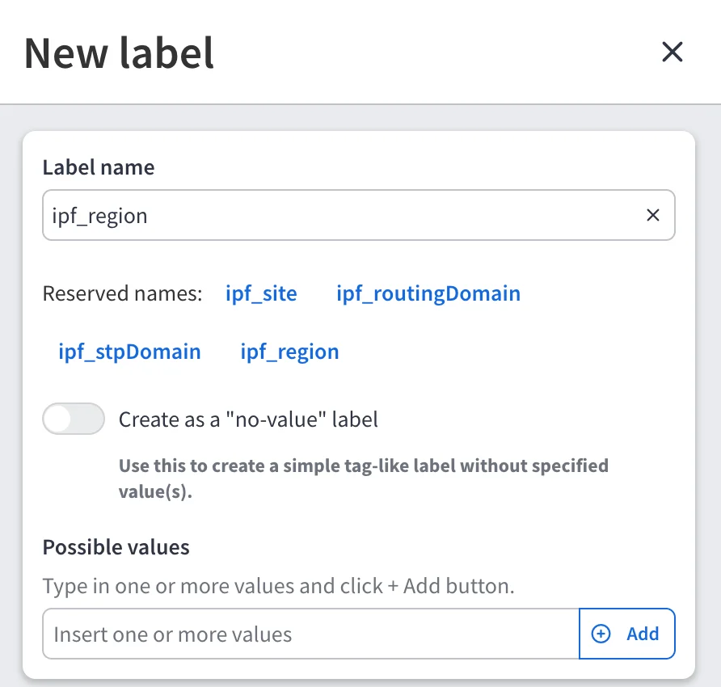
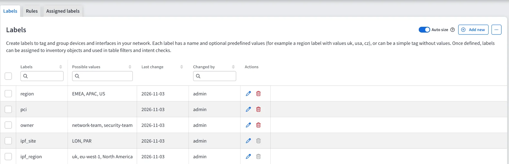

# Reserved Labels

--8<-- "snippets/labels_experimental.md"

Since `8.2`, label names starting with `ipf_` are reserved. IP Fabric uses
reserved labels to publish the site, routing domain, and STP domain it
calculates for each device. You can override these values, and you can assign
devices to regions with the `ipf_region` label.

## Available Reserved Labels

| Label               | Value                                   | Set by                                                                                               |
| ------------------- | --------------------------------------- | ---------------------------------------------------------------------------------------------------- |
| `ipf_site`          | Site name of the device                 | IP Fabric, from [site separation](../Discovery_and_Snapshots/Discovery_Settings/site_separation.md) |
| `ipf_routingDomain` | Routing domain of the device            | IP Fabric, during topology calculation                                                               |
| `ipf_stpDomain`     | STP domain of the device                | IP Fabric, during topology calculation                                                               |
| `ipf_region`        | Region of the device, for example `uk` | You only -- manually or with [rules](automatic_assignment_rules.md)                                  |

Only these four names can be used. Any other name starting with `ipf_` is
rejected with the error:

```
The ipf_ prefix is only for reserved labels.
```

Reserved labels are assigned to devices.

## Labels Computed by IP Fabric

During each topology calculation, IP Fabric assigns `ipf_site`,
`ipf_routingDomain`, and `ipf_stpDomain` to each device in the snapshot that has
a site, routing domain, or STP domain. These assignments have the source **IP
Fabric**, and IP Fabric replaces them every time topology is calculated.

### Overriding a Computed Value

To change the site, routing domain, or STP domain IP Fabric calculated for a
device, assign the reserved label with your own value -- either
[manually](create_and_assign_labels.md#assign-a-label) or with an
[automatic assignment rule](automatic_assignment_rules.md). For example,
assign `ipf_site:LON` to move a device to the `LON` site.

When you pick a computed reserved label in an assignment or rule form, a
warning reminds you that you are overriding the value IP Fabric calculated --
for example:

```
You are overriding the site name computed by IP Fabric.
```



Manual and auto-assigned values take precedence over the computed value:

1. **Manual**
2. **Auto-assigned**
3. **IP Fabric**
4. **Inherited**

To keep a manual override in future snapshots, turn on **Apply to future
snapshots** when assigning it.

A device has only one value of each reserved label. When several values reach
the same device, only the value with the highest precedence applies. This
differs from user labels, where a device keeps every assigned value.

In the **Labels** tab of
[Device Explorer](create_and_assign_labels.md#edit-labels-in-device-explorer),
both the computed value (source **IP Fabric**) and your override (source
**Manual**) are listed. The override is the one IP Fabric uses.



### Where Reserved Labels Are Used

When labels are enabled, IP Fabric reads the reserved label first, and falls
back to the calculated value only for devices without it:

- **Site** columns in technology and inventory tables show the value of
  `ipf_site`.
- **Diagrams** group devices by **Site name**, **Routing domain**, and
  **STP domain** using `ipf_site`, `ipf_routingDomain`, and `ipf_stpDomain`.



Overriding a reserved label changes how the device is shown in tables and
diagrams. It does not change the site separation settings.

## Regions

`ipf_region` groups devices into regions -- for example, `uk`, `eu-west-1`, or
`North America`. IP Fabric never computes it, so devices carry a region only
after you assign one, manually or with a rule.

Once assigned, you can group diagrams by **Region**. The **Region** option is
available only when labels are enabled.



Devices without `ipf_region` are grouped under **NO VALUE**.



A region value is required, and it must be 1--64 characters long and contain
only letters, digits, spaces, underscores (`_`), periods (`.`), or hyphens
(`-`). Otherwise, the following error is shown:

```
Region value must be 1–64 characters: letters, digits, spaces, "_", "." or "-".
```

!!! example

    To assign regions automatically by hostname, create a rule with the
    condition **Hostname** is `^lon-` and the label `ipf_region:uk`. Every
    device whose hostname starts with `lon-` is placed in the `uk` region.

## Reserved Labels in the Catalog

Reserved labels are not added to the [catalog](create_and_assign_labels.md#create-a-label-in-the-catalog)
automatically. To add one, click **+ Add new** in the **Labels** tab and select
one of the names offered under **Reserved names**.



Reserved catalog entries cannot be renamed or deleted. You can still edit their
values. A catalog entry for `ipf_region` must have at least one value.



## API

Reserved labels use the same API endpoints as other labels. See
[Import Labels via API](import_labels_via_api.md).

- A request with an unknown `ipf_` name, or a missing or invalid `ipf_region`
  value, fails with status `422` and the error code `API_VALIDATION_FAILED`.
- A request that renames or deletes a reserved catalog entry fails with status
  `400` and the message `Reserved label names cannot be renamed or deleted.`

For example, to assign a device to the `uk` region:

```shell
curl -X POST 'https://<FQDN>/api/labels/assignments' \
  --header 'Content-Type: application/json' \
  --header 'X-API-Token: <YOUR_API_TOKEN>' \
  -d '{
    "snapshotId": "<SNAPSHOT_ID>",
    "labels": [{ "name": "ipf_region", "value": "uk" }],
    "targets": [{ "type": "device", "sn": "<DEVICE_SN>" }],
    "reflectToRules": true
  }'
```
