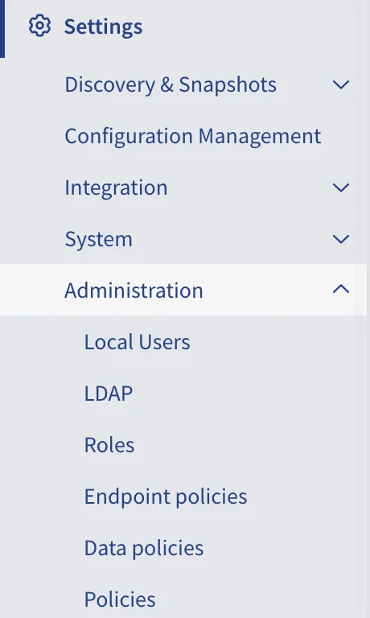
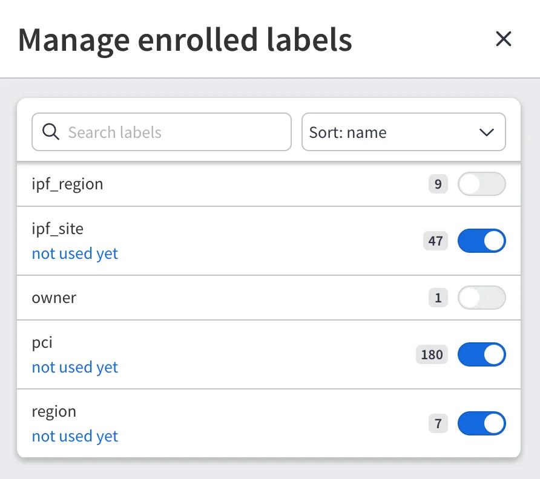
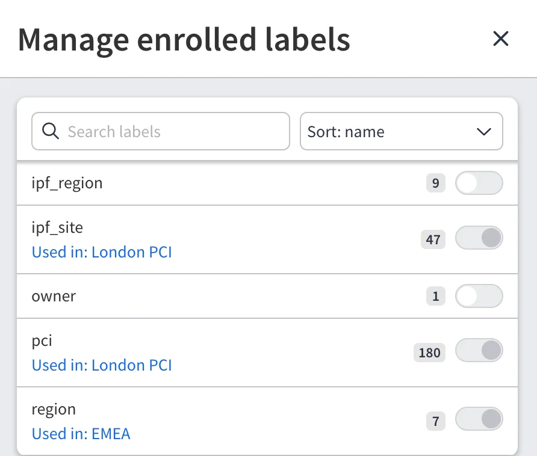
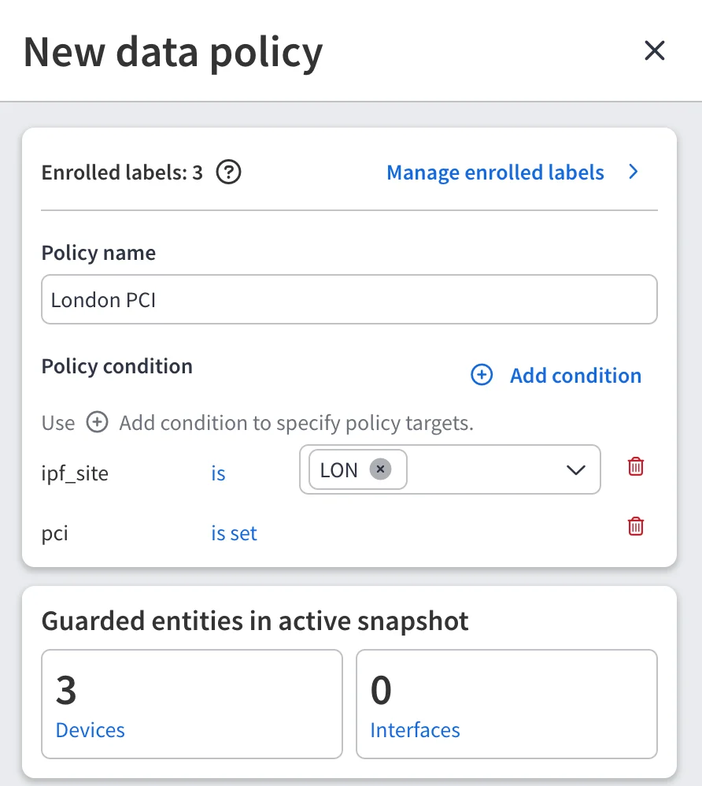
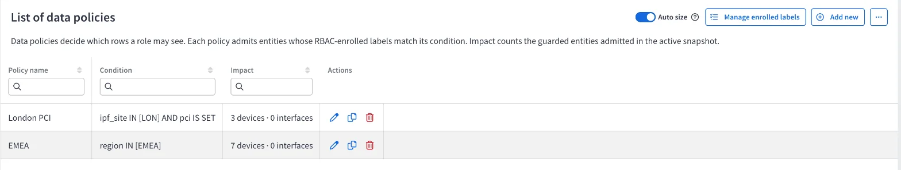
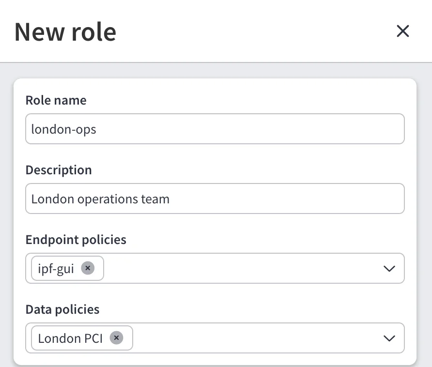
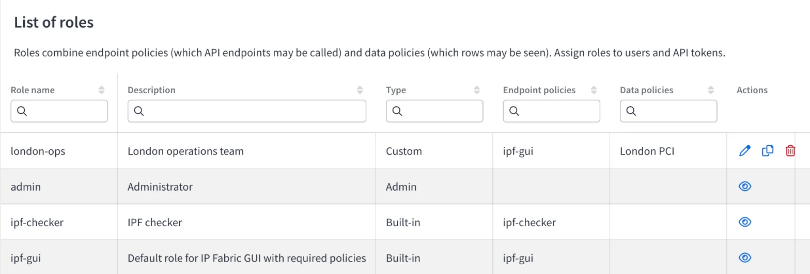
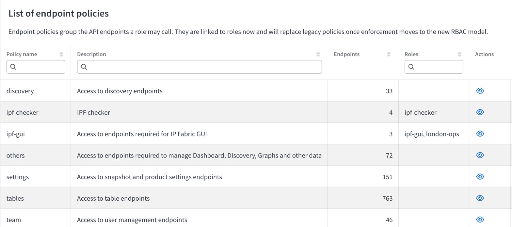

# Label-Based Access Control

!!! warning "Experimental Feature"

    Label-based access control is an experimental feature introduced in `8.2`.
    It is part of [Labels](../Discovery_Data_Enrichment/index.md) and is
    disabled by default. To enable it, set the `ENABLE_LABELS` feature flag. See
    [Feature Flags](../../System_Administration/Command_Line_Interface/Feature_Flags.md#labels)
    for details.

Since `8.2`, you can restrict which devices and interfaces a role can see, based
on the [labels](../Discovery_Data_Enrichment/index.md) assigned to them. For
example, a role for the London operations team can be limited to devices
labeled `ipf_site:LON`.

Label-based access control extends [Role-Based Access Control (RBAC)](index.md#role-based-access-control-rbac)
with three building blocks:

- **Enrolled labels** -- Labels you explicitly allow to be used for access
  control.
- **Data policies** -- Conditions on enrolled labels that decide which rows a
  role may see.
- **Endpoint policies** -- Sets of API endpoints a role may call.

A role combines endpoint policies (which API endpoints may be called) and data
policies (which rows may be seen). Roles are then assigned to users and API
tokens.

With `ENABLE_LABELS` enabled, **Settings --> Administration** contains two new
pages, **Endpoint policies** and **Data policies**, and the **Roles** page lets
you link both kinds of policies to a role.



## How Access Is Evaluated

- Data policies restrict **devices** and **interfaces**. A device or interface
  is visible to a restricted user only if at least one of the user's data
  policies admits it. Devices and interfaces that no policy admits -- including
  those without labels -- are hidden.
- Devices and interfaces are evaluated separately. A device admitted by a
  policy does not make its interfaces visible -- interfaces must carry the
  labels themselves, for example through
  [inheritance](../Discovery_Data_Enrichment/create_and_assign_labels.md#assign-a-label).
- The restriction applies to table rows built from devices or interfaces --
  the inventory tables and most technology tables -- in both the GUI and the
  API. Diagrams and other views are not filtered.
- When a user has several roles, or a role has several data policies, the user
  sees everything admitted by **any** of the policies (union).
- A user is **not restricted** at all when:
    - any of the user's roles is an administrator role,
    - any of the user's roles has no data policy, or
    - the user has no roles (such a user has no access to API endpoints
      either).

!!! important "Roles Without Data Policies Grant Full Access"

    A single role without a data policy gives the user unrestricted access,
    regardless of the user's other roles. To restrict a user, make sure that
    every role assigned to the user has at least one data policy.

    Built-in roles, such as `ipf-gui` and `ipf-checker`, cannot have data
    policies, so they always grant unrestricted access. New local users get the
    `ipf-gui` role by default. To restrict a user, remove every built-in role
    from the user and assign only custom roles with data policies. To keep GUI
    access, add the `ipf-gui` endpoint policy to the custom role instead.

API tokens are evaluated by the roles assigned to the token, not the roles of
the user who created it. A token created by an administrator is restricted if
all of its roles have data policies.

Access is recalculated immediately when you change a data policy or label
assignments, and after every discovery.

## Step 1: Enrol Labels for RBAC

A label must be enrolled before a data policy can use it. All labels start
un-enrolled, so enrolling a label never changes access by itself.

1. Go to **Settings --> Administration --> Data policies** and click
   **Manage enrolled labels**.
2. Turn on the switch next to each label you want to use in data policies. The
   badge next to each label shows how many objects carry it in the selected
   snapshot.
3. Click **Save**.



A snapshot must be selected to manage enrolled labels.

A label used by a data policy cannot be un-enrolled. Its switch is locked with
the tooltip:

```
Used by data policies. Remove it from those policies before un-enrolling.
```

The label also shows the policies that use it -- for example,
**Used in: London PCI**.



While a data policy uses a label, the label also cannot be renamed or deleted
in the [catalog](../Discovery_Data_Enrichment/create_and_assign_labels.md#create-a-label-in-the-catalog),
and values used by the policy cannot be removed from it.

## Step 2: Create a Data Policy

1. Go to **Settings --> Administration --> Data policies** and click
   **+ Add new**.
2. Enter a **Policy name**.
3. In **Policy condition**, click **Add condition** and pick an enrolled label:
    - For a label with values, select one or more values -- for example,
      `ipf_site` **is** `LON`, `PAR`. The condition matches objects carrying any
      of the selected values.
    - For a label without values, the condition is **is set** -- it matches
      objects carrying the label.
4. Add more conditions as needed. An object must match **all** conditions.
5. Check **Guarded entities in active snapshot** to see how many devices and
   interfaces the policy admits.
6. Click **Save**.



The **Data policies** table shows each policy's condition -- for example,
`ipf_site IN [LON] AND pci IS SET` -- and its **Impact**, the number of devices
and interfaces it admits in the active snapshot.



A data policy applies to all snapshots.

Each label can be used only once in a policy. Conditions are always combined
with `AND`; to admit objects matching one of several conditions (`OR`), create
a separate data policy for each and add them all to the role.

## Step 3: Assign Policies to Roles

1. Go to **Settings --> Administration --> Roles**.
2. Add a new role or edit an existing one.
3. In **Endpoint policies**, select the policies defining which API endpoints
   the role may call. For GUI access, include the `ipf-gui` endpoint policy.
4. In **Data policies**, select the policies defining which devices and
   interfaces the role may see.
5. Save the role and [assign it to users](users.md) or
   [API tokens](../integration/api_tokens.md). Remove the built-in `ipf-gui`
   role and any other role without a data policy from those users and tokens.



The **Roles** table lists the endpoint and data policies of each role.
Administrator and built-in roles are read-only.



Deleting a data policy removes it from every role it is assigned to. If it was
the role's only data policy, the role then grants unrestricted access.

## Endpoint Policies

Endpoint policies group the API endpoints a role may call. They are the same
API endpoint policies described in [Policies](policies.md), shown on a separate
page so they can be linked to roles alongside data policies. The built-in
policies cannot be edited or deleted.

To create one, go to **Settings --> Administration --> Endpoint policies**,
click **+ Add new**, enter a **Policy name** and an optional **Description**,
and select the endpoints in **Select endpoints for policy**.



## API

The built-in **team** policy grants access to the endpoints below.

| Method and Path                         | Description                                          |
| --------------------------------------- | ---------------------------------------------------- |
| `GET /labels/rbac-enrolment`            | List labels with their enrolment state (query parameter `snapshotId`) |
| `PUT /labels/rbac-enrolment`            | Enrol and un-enrol labels                            |
| `GET /data-policies`                    | List data policies                                   |
| `POST /data-policies`                   | Create a data policy                                 |
| `PUT /data-policies/{id}`               | Update a data policy                                 |
| `DELETE /data-policies/{id}`            | Delete a data policy                                 |
| `GET /data-policies/impact`             | Impact counts per policy (query parameter `snapshotId`) |
| `POST /data-policies/impact/preview`    | Preview the impact of a condition                    |
| `GET /endpoint-policies`                | List endpoint policies                               |
| `POST /endpoint-policies`               | Create an endpoint policy                            |
| `PUT /endpoint-policies/{id}`           | Update an endpoint policy                            |
| `DELETE /endpoint-policies/{id}`        | Delete an endpoint policy                            |

### Enrol a Label

`PUT /labels/rbac-enrolment` takes a change, not the full list. Use the label
`id` from `GET /labels`:

```shell
curl -X PUT 'https://<FQDN>/api/labels/rbac-enrolment' \
  --header 'Content-Type: application/json' \
  --header 'X-API-Token: <YOUR_API_TOKEN>' \
  -d '{
    "enrol": ["<LABEL_ID>"],
    "unenrol": []
  }'
```

### Create a Data Policy

```shell
curl -X POST 'https://<FQDN>/api/data-policies' \
  --header 'Content-Type: application/json' \
  --header 'X-API-Token: <YOUR_API_TOKEN>' \
  -d '{
    "name": "London",
    "condition": {
      "version": 1,
      "match": "all",
      "terms": [
        { "label": "ipf_site", "op": "in", "values": ["LON"] },
        { "label": "pci", "op": "exists" }
      ]
    }
  }'
```

| Field              | Description                                                                                        |
| ------------------ | -------------------------------------------------------------------------------------------------- |
| `name`             | Unique policy name, 1--255 characters.                                                             |
| `description`      | Optional description, up to 2000 characters.                                                       |
| `condition.version`| Always `1`.                                                                                        |
| `condition.match`  | Always `all` -- an object must match every term.                                                   |
| `condition.terms`  | At least one term, at most one per label. The label must be enrolled.                             |
| `op: "in"`         | Matches objects carrying the label with any of the listed `values` (at least one value required).  |
| `op: "exists"`     | Matches objects carrying the label. Used for labels without values, such as `pci`.                 |

### Link Policies to a Role

Use the roles API with the `X-API-Version: 2` header, which adds the
`endpointPolicyIds` and `dataPolicyIds` fields. `PUT` requires the full role,
so first read the role:

```shell
curl 'https://<FQDN>/api/roles/<ROLE_ID>' \
  --header 'X-API-Version: 2' \
  --header 'X-API-Token: <YOUR_API_TOKEN>'
```

Then send it back with the data policies added:

```shell
curl -X PUT 'https://<FQDN>/api/roles/<ROLE_ID>' \
  --header 'Content-Type: application/json' \
  --header 'X-API-Version: 2' \
  --header 'X-API-Token: <YOUR_API_TOKEN>' \
  -d '{
    "name": "london-ops",
    "description": "London operations team",
    "policyIds": ["<POLICY_ID>"],
    "dataPolicyIds": ["<DATA_POLICY_ID>"]
  }'
```

When `dataPolicyIds` is omitted, data policy links are left unchanged. When
`endpointPolicyIds` is omitted, endpoint policy links are set from `policyIds`,
so send back the `policyIds` returned by `GET`. Built-in roles cannot be
changed (`403`).

## Configuration Export and Import

Data policies, their links to roles, and label enrolment are included in the
appliance configuration export and import. After an import, IP Fabric
recalculates access for all loaded snapshots in the background. Until the
recalculation finishes, restricted users may see rows according to the
previous policies.

## Limitations

- Only devices and interfaces are restricted. Cloud constructs are not.
- Conditions support `AND` only. There is no `NOT` or exclusion; use separate
  data policies to combine alternatives.
- Without a selected snapshot, impact counts and enrolled labels are not shown.
