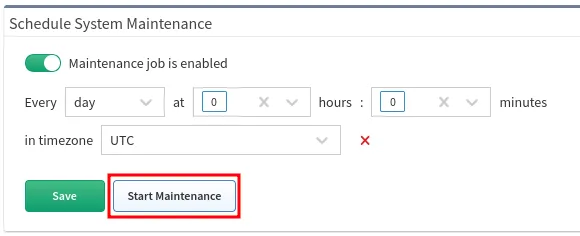

# Schedule System Maintenance

Settings location: **Settings --> System --> Backup & Maintenance --> Schedule
System Maintenance**

To ensure the platform's good health, it's highly recommended to regularly run
System Maintenance. The recommended frequency for System Maintenance is once a
day.

Even though the process is very quick, we recommend performing it when no one is
working with IP Fabric, as the platform is not available during maintenance.

If you access the IP Fabric GUI during maintenance, you will see the `We'll be
back soon!` message.

Sometimes, it is necessary to run maintenance manually; this can be done with
the **Start Maintenance** button:

## Cleaning Up Job Files

--8<-- "snippets/jobs_clear_all_files.md"

To reclaim disk space occupied by such files:

1. In the **Jobs** list, click **Clear all** to dismiss the finished and failed
   job entries.
2. Run System Maintenance manually with the **Start Maintenance** button, or
   wait for the scheduled maintenance to run.
